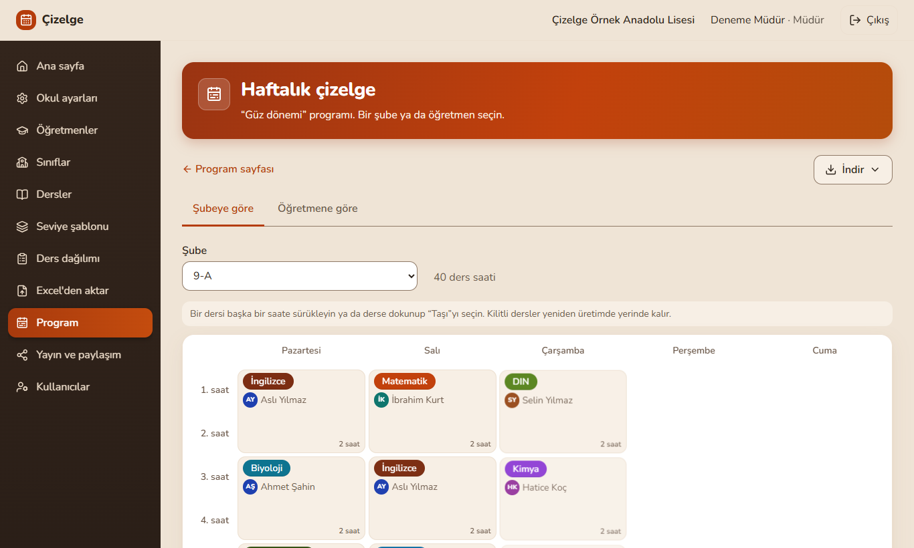
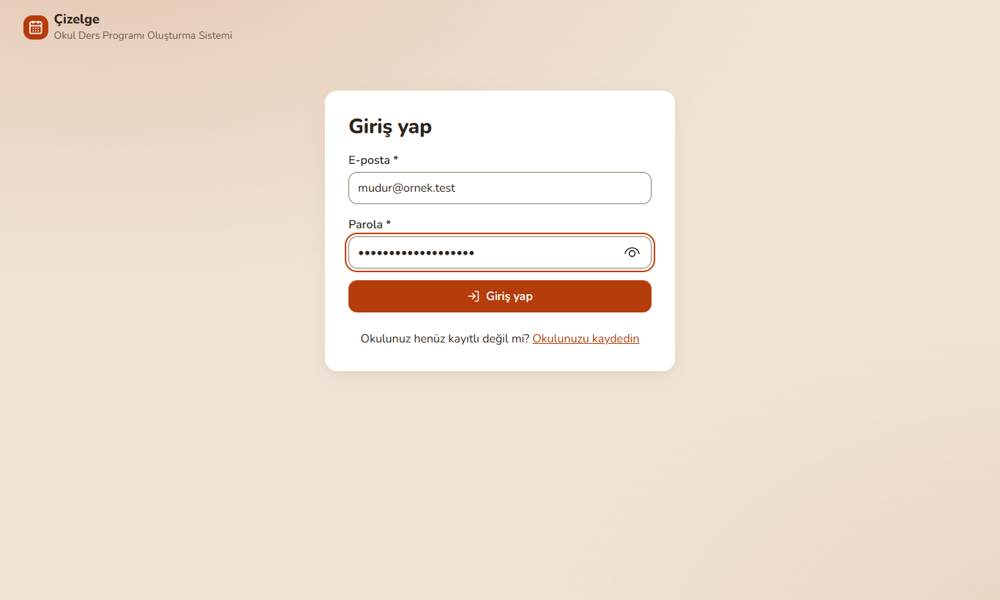
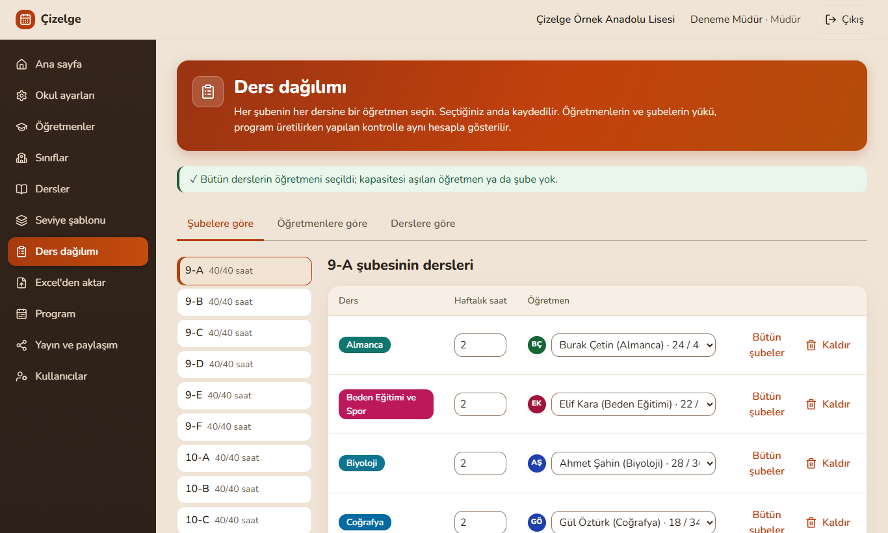
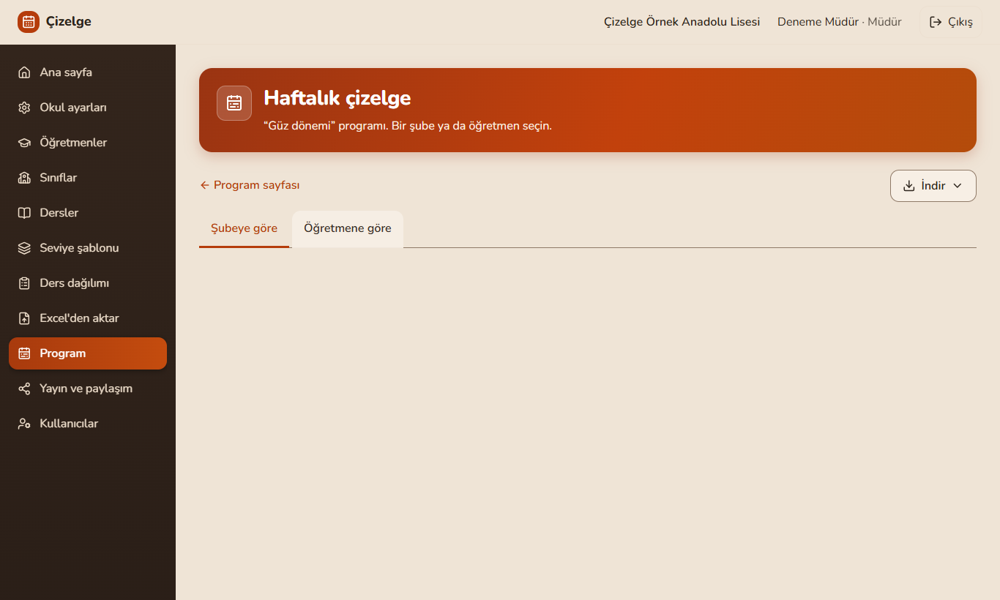
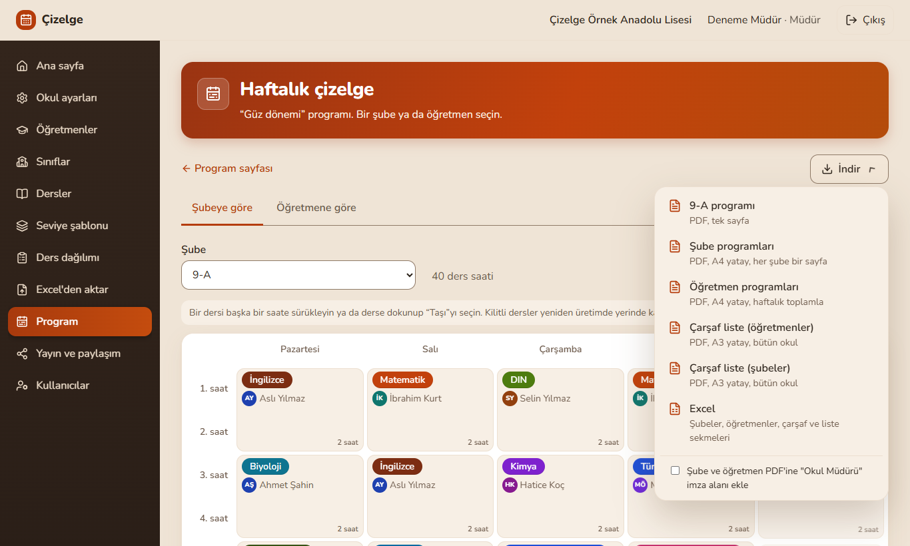
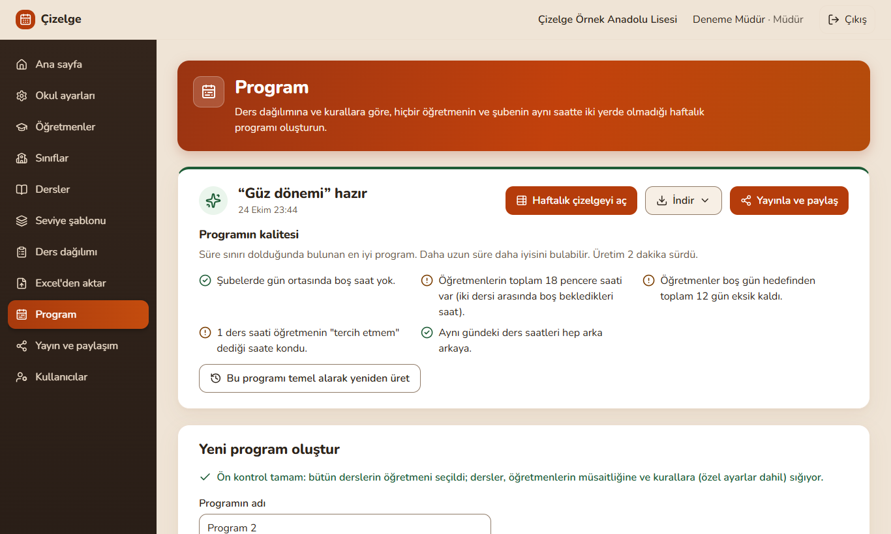
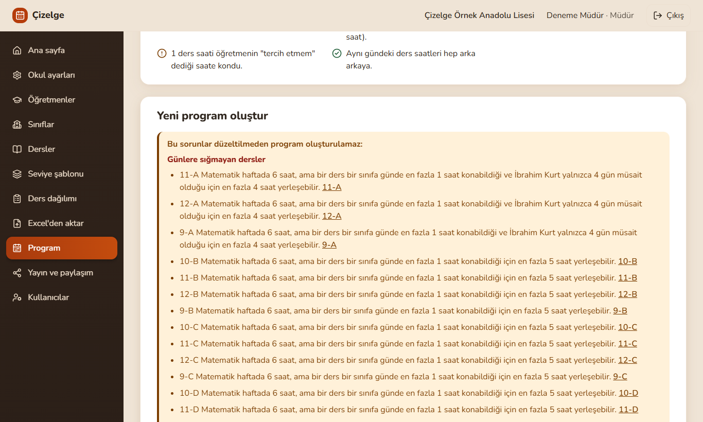

# Çizelge – Okul Ders Programı Oluşturma Sistemi

Okullar için çakışmasız haftalık ders programı üreten, çok okullu (multi-tenant) bir web uygulaması.
Okul yöneticisi öğretmenleri, şubeleri, dersleri ve kimin hangi şubeye hangi dersi haftada kaç saat
verdiğini girer; kuralları ayarlar. Sistem arka planda, hiçbir öğretmenin ve şubenin aynı saatte iki
yerde olmadığı bir program üretir. Yönetici sonucu görür, sürükleyip bırakarak düzeltir, yayımlar,
PDF ve Excel olarak alır.

Yazılım Tasarımı ve Mimarisi dersi dönem projesi. Kapsamın ve kararların tek doğruluk kaynağı
[CLAUDE.md](CLAUDE.md); proje raporu [docs/rapor.md](docs/rapor.md) ([PDF](docs/rapor.pdf)); UML
diyagramları [docs/diyagramlar/](docs/diyagramlar/) ([hepsi A3 PDF](docs/diyagramlar/diyagramlar.pdf)).



## Ne yapar

- **Veri girişi:** okul ayarları (gün sayısı, günlere göre ders saati, öğle arası, zil saatleri),
  öğretmen, şube, şube grubu ve ders listeleri; Excel'den içe aktarma.
- **Ders dağılımı:** seviye (ya da şube grubu) şablonu bir kez tanımlanır, şubelere uygulanır;
  şubeye özel "bu dersi almaz / ek alır" istisnaları korunur. Her derse öğretmen seçilir, öğretmen
  yükleri anında görünür.
- **Kurallar:** zorunlu kurallar (çakışma yok, müsaitlik, günlük sınırlar, blok dersler, kilitler)
  ve "Önemsiz / Önemli / Çok önemli" ağırlıklı esnek kurallar (sınıf boşluğu, öğretmen penceresi,
  boş gün, tercih etmez, dersin saat tercihi...). Kurallar derse, şubeye, gruba ya da öğretmene özel
  ayarlanabilir.
- **Program üretme:** kuyruk üzerinden, durum takibiyle; çözüm yoksa nedeni kullanıcının diliyle
  ("... 24 saat dersi var, müsait olduğu 20 saat var"). Mevcut programı temel alarak en az
  değişiklikle yeniden üretme.
- **Elle düzeltme:** sürükle bırak (hedefte aynı şubenin dersi varsa yer değiştirir), çakışma
  uyarısı, hücre kilitleme, geri alma.
- **Çıktı ve paylaşım:** şube/öğretmen PDF'leri, çarşaf liste, Excel; programı yayımlama ve
  öğretmenlere girişsiz, salt okunur paylaşım linki.

## Mimari özeti

```
Tarayıcı (React)
     |  aynı köken: /api
     v
API (FastAPI, modüler monolit)  ---->  PostgreSQL (RLS)
     |                                     ^
     v                                     |
Kuyruk (Redis + RQ)  ---->  Worker  ---->  Çözücü (saf Python, OR-Tools CP-SAT)
```

- **Çözücü API'den ayrı çalışır:** üretim dakikalar sürebilir; worker'da çalıştığı için API'nin
  diğer istekleri beklemez. Worker sayısı `--scale` ile artırılır.
- **Çözücü bir arayüzün arkasındadır** (`ProgramCozucu` → `CpSatCozucu`) ve **her kural ayrı bir
  sınıftır** (strategy deseni): yeni kural mevcut kodu değiştirmeden eklenir.
- **Okul izolasyonu üç katmanlıdır:** ORM her sorguya okul koşulunu tek yerden ekler, bileşik
  yabancı anahtarlar okullar arası ilişkiyi, PostgreSQL satır düzeyi güvenliği (RLS) başka okulun
  satırlarını görmeyi engeller. Aktif okul yalnızca oturumdan gelir.
- **API modüler monolittir:** çekirdek (okul, kullanıcı, öğretmen, şube, ders) ders programı
  modülünü bilmez; modül çekirdeğe bir sözleşmeyle kaydolur.
- **Kimlik doğrulama sunucu taraflı oturumladır:** `HttpOnly`, `SameSite=Strict` çerez, argon2id,
  köken denetimi; arayüz ile API aynı kökenden görünür, CORS yoktur.

Her önemli kararın gerekçesi ve alternatifleri [docs/adr/](docs/adr/) altındadır (25 karar kaydı).

## Kurulum (Docker Compose)

Gereken tek şey Docker (Docker Desktop ya da Docker Engine + Compose eklentisi). Bilgisayarda
Python ya da Node kurulu olması gerekmez.

**1. Sistemi başlatın** (depo kökünde; ilk derleme ve arayüz paketlerinin kurulumu birkaç dakika
sürer):

```bash
docker compose up --build -d --wait
```

`--wait`, bütün servisler sağlıklı olana kadar bekler; arayüz de sayfayı vermeye başlayınca
döner (ilk açılışta `npm ci` yüzünden birkaç dakika). Beş konteyner çalışır: `db` (PostgreSQL 17),
`redis` (iş kuyruğu), `api` (FastAPI), `worker` (program üretimi), `web` (arayüz).
Bağımlılıklar kilitli sürümlerle kurulur: Python paketleri `api/requirements.lock` (çözücüyü tek
başına geliştirmek için `cozucu/requirements.lock`), arayüz paketleri `web/package-lock.json`
(`npm ci`); böylece temiz kurulum testlerin geçtiği sürümleri alır.

**2. Migration'lar** kendiliğinden uygulanır: `api` konteyneri başlarken önce
`python -m okulapi.migrasyon upgrade heads` çalıştırır, sonra API'yi açar. Elle çalıştırmak
gerekirse:

```bash
docker compose exec api python -m okulapi.migrasyon upgrade heads
```

**3. Örnek okulu yükleyin.** Veritabanındaki bütün okulları silip örnek bir okul kurar; bu yüzden
`OKULAPI_ORTAM=gelistirme` ve `--evet` olmadan çalışmaz. `--set gercekci`: 24 şube, 42 öğretmen,
330 ders ataması (`--set` verilmezse 3 şubelik mini set):

```bash
docker compose exec -e OKULAPI_ORTAM=gelistirme api python -m okulapi ornek-okul --evet --set gercekci
```

**4. Giriş:** http://localhost:5173 adresini açın, `mudur@ornek.test` / `ornek-okul-parolasi` ile
giriş yapın. Kendi okulunuzu kurmak için giriş sayfasındaki "Okulunuzu kaydedin" bağlantısı kullanılır.

| Adres | Ne |
|---|---|
| http://localhost:5173 | Arayüz |
| http://localhost:8000/docs | API belgeleri (Swagger) |
| http://localhost:8000/api/saglik | Sağlık kontrolü (API ve veritabanı) |
| `localhost:5433` | PostgreSQL (yalnızca testler ve inceleme için) |

**Port doluysa:** `.env.example` dosyasını `.env` adıyla kopyalayıp `WEB_PORT`, `API_PORT`,
`DB_PORT` değerlerini değiştirin; arayüz adresi `http://localhost:<WEB_PORT>` olur, API'nin köken
denetimi yeni portu kendiliğinden izler.

**Durdurma:** `docker compose down`; veritabanını da silmek için `docker compose down -v`.

Müdür parolasını unutursa sunucuyu işleten kişi (API'den erişilemez):

```bash
docker compose exec api python -m okulapi parola-sifirla mudur@ornek.test
```

## Kısa kullanım kılavuzu

Sol menü işin sırasını izler; ana sayfa okulun durumunu özetler.

1. **Okul kur:** giriş sayfasından okul kaydı (okul adı, müdür, e-posta, en az 12 karakterlik
   parola). **Okul ayarları**'nda gün sayısı, günlük ders saati (gerekirse günlere göre), öğle
   arası ve zil saatleri; **Gelişmiş** bölümünde kuralların önemi.
2. **Öğretmen ve ders gir:** **Öğretmenler**, **Sınıflar** (şubeler ve şube grupları) ve
   **Dersler** sayfalarında elle ya da **Excel'den aktar** sayfasındaki şablonla toplu olarak.
   Öğretmen sayfasında müsaitlik çizelgesi (gelemez / tercih etmez) ve öğretmene özel ayarlar
   (günlük sınır, boş gün hedefi) girilir.
3. **Ders dağılımı:** **Seviye şablonu**'nda bir seviyenin (ya da şube grubunun) dersleri ve haftalık
   saatleri bir kez yazılıp şubelere uygulanır. **Ders dağılımı** sayfasında her derse öğretmen
   seçilir; öğretmen görünümünde toplam yük ve uyarılar görünür.
4. **Program üret:** **Program** sayfasında ad ve süre ("Hızlı" 30 sn, "Dengeli" 2 dk, "Uzun" 5 dk) seçilip
   **Programı oluştur**'a basılır. Durum birkaç saniyede bir yenilenir
   (`bekliyor → uretiliyor → hazir`). Ön kontrol ya da çözücü bir çelişki bulursa nedeni ve ilgili
   öğretmen/şube listelenir.
5. **Elle düzelt:** çizelgede bir ders taşınırken hedef hücreler boyanır: uygun olanlar yeşil,
   esnek bir kuralı bozanlar sarı kesik çizgili, zorunlu kuralı bozanlar taralı ve soluk. Hedefte
   aynı şubenin dersi varsa ikisi yer değiştirir. Hücre kilitlenebilir (yeniden üretimde yerinde kalır),
   her işlem **Geri al** ile geri alınır. Mevcut programı temel alıp "en az değişiklikle yeniden
   üret" seçilebilir.
6. **Yayımla:** **Yayın** sayfasında program yayımlanır; okul, şube ya da öğretmen için girişsiz
   paylaşım linki oluşturulur. Yayın dondurulmuştur: veri değişirse "eski veriyle üretildi" uyarısı
   çıkar.
7. **PDF / Excel al:** çizelgedeki **İndir** menüsünden şube PDF'leri (A4, her şube bir sayfa),
   öğretmen PDF'leri, çarşaf liste (A3) ya da Excel (şubeler, öğretmenler, çarşaf ve liste
   sekmeleri).

## Ekran görüntüleri

Gerçekçi örnek okulla, temiz bir kurulumda alınmıştır (`docs/ekranlar/teslim/`).

| | |
|---|---|
|  |  |
| Giriş | Ders dağılımı: şubelere göre öğretmen seçimi |
|  |  |
| Üretilen program, şube görünümü | Öğretmen görünümü |
|  |  |
| PDF ve Excel çıktıları | Programlar ve kalite özeti |
|  | |
| Çözüm yoksa: ön kontrol nedeni kullanıcının diliyle söyler, üretme kapanır (deneme için günlük ders sınırı geçici olarak 1 yapıldı) | |

Geliştirme sırasında her adımın sonunda alınan görüntüler (`docs/ekranlar/<adım>/`) teslimde
depodan çıkarıldı; git geçmişinde (`a6c50df` ve öncesi) durur.

## Testler

Testler gerçek PostgreSQL'e karşı çalışır (`localhost:5433`; `okul_test` veritabanı her
çalıştırmada migration'larla sıfırdan kurulur). Önce yalnızca veritabanı:

```bash
docker compose up -d db
```

Çözücü (veritabanı gerekmez):

```bash
cd cozucu && python -m venv .venv && .venv/Scripts/pip install -c requirements.lock -e ".[test]" && .venv/Scripts/python -m pytest
```

API (çözücü ve worker paketleriyle birlikte; kuyruk bellek içi ikizle, RQ fakeredis ile sınanır):

```bash
cd api && python -m venv .venv && .venv/Scripts/pip install -c requirements.lock -e ../cozucu -e ".[test]" -e ../worker && .venv/Scripts/python -m pytest
```

Arayüz: tip denetimi, lint ve testler (Vitest + Testing Library + MSW; API gerekmez):

```bash
cd web && npm ci && npm run denetim
```

Uçtan uca testler çalışan bütün sisteme bağlanır (`docker compose up -d --build --wait` ve örnek
okul yüklendikten sonra). API tarafı (kuyruk akışı, kayıt/giriş, köken denetimi) ve tarayıcı tarafı
(Playwright, bilgisayardaki Edge ile; masaüstü ve telefon boyutu):

```bash
cd api && .venv/Scripts/python -m pytest -m uctan_uca -s
```

```bash
cd web && npm run e2e
```

Linux/macOS'ta `.venv/Scripts/` yerine `.venv/bin/` kullanılır. Uzun süren ölçüm testleri
`-m slow` ile ayrıca çalıştırılır. Diyagram-kod tutarlılığı API testlerinin parçasıdır
(`api/tests/test_diyagramlar.py`).

### Çözücüyü komut satırından çalıştırma

```bash
cd cozucu && .venv/Scripts/python -m cozucu ../veri/mini.json --sinif 9-A
```

## Geliştirme notları

- **Arayüzü Docker olmadan** çalıştırmak için (Node 22; API `localhost:8000`'de çalışıyor olmalı):
  `cd web && npm ci && npm run dev`. Vite'ın proxy'si `/api` isteklerini API'ye iletir
  (ADR 0013). Yayında arayüz derlenir (`npm run build`) ve API ile aynı alan adının arkasına, bir ters
  vekil sunucuyla (nginx, Caddy) HTTPS üzerinden konur; `OKULAPI_CEREZ_SECURE` verilmez (varsayılan
  açık), `OKULAPI_IZINLI_KOKENLER` yayın adresini içerir.
- **Veritabanı rolleri:** `okul_sahip` (tablo sahibi, migration'lar), `okul_uygulama` (api ve
  worker; RLS'ye tabi, yalnızca DML), `okul_giris` ve `okul_paylasim` (`NOLOGIN`; okul bilinmeden
  arama yapan `SECURITY DEFINER` fonksiyonların sahipleri). `docker-compose.yml`'deki parolalar
  yalnızca geliştirme içindir.
- **API değişince** arayüzün tipleri yenilenir (yenilenmezse api ve web testlerinden biri kırılır):
  `api/.venv/Scripts/python scripts/openapi_yaz.py`, sonra `cd web && npm run api:tipler`.
- **Diyagramlar:** `python scripts/diyagramlari_uret.py` (PlantUML, sürümü sabit Docker imajı) ve
  `api/.venv/Scripts/python scripts/diyagram_pdf.py` (A3 PDF). Ayrıntı:
  [docs/diyagramlar/README.md](docs/diyagramlar/README.md).

## Belgeler

- [CLAUDE.md](CLAUDE.md): kapsam, mimari, veri modeli, çözücü kuralları, yapım sırası
- [docs/rapor.md](docs/rapor.md): proje raporu; [docs/sunum-taslagi.md](docs/sunum-taslagi.md): sunum içeriği
- [docs/adr/](docs/adr/): mimari karar kayıtları
- [docs/olcumler.md](docs/olcumler.md): çözücü süre ve kalite ölçümleri
- [docs/cozucu-plani.md](docs/cozucu-plani.md), [docs/api-plani.md](docs/api-plani.md), [docs/kuyruk-plani.md](docs/kuyruk-plani.md), [docs/kimlik-plani.md](docs/kimlik-plani.md), [docs/arayuz-plani.md](docs/arayuz-plani.md), [docs/kisisellestirme-plani.md](docs/kisisellestirme-plani.md): adım planları

## Klasörler

```
cozucu/    Saf Python çözücü paketi (OR-Tools CP-SAT) ve testleri
api/       FastAPI uygulaması (okulapi): çekirdek + modüller
worker/    Kuyruk işçisi (okulworker): modülleri bilmeyen genel çalıştırıcı
web/       Arayüz (React + TypeScript + Vite)
docker/    Konteyner başlangıç betikleri
docs/      Rapor, diyagramlar, ADR'ler, planlar, ölçümler, ekran görüntüleri
veri/      Test veri setleri (mini, gerçekçi, büyük; adlar uydurmadır)
scripts/   Diyagram, ölçüm ve yardımcı betikler
```
