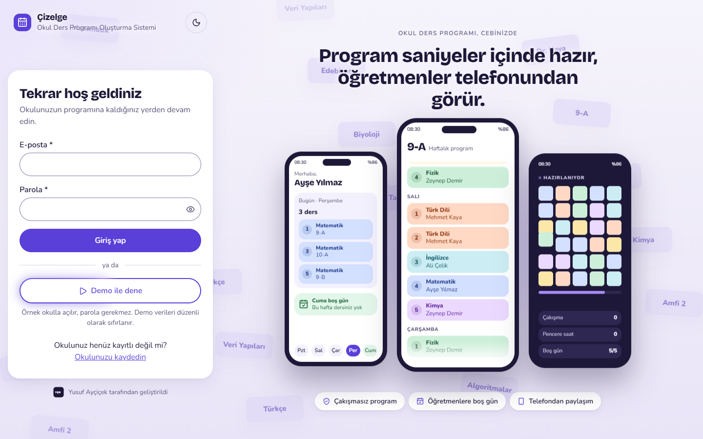
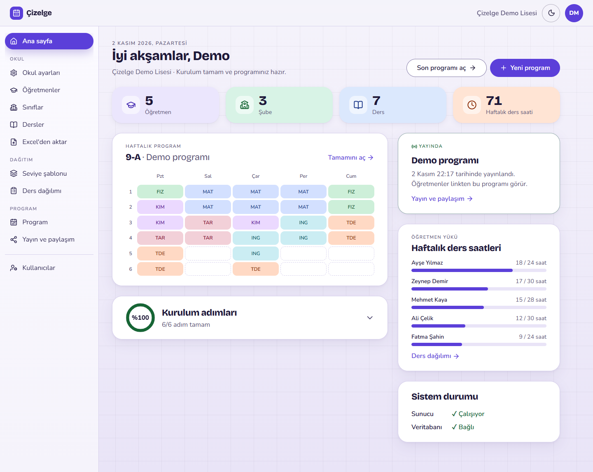
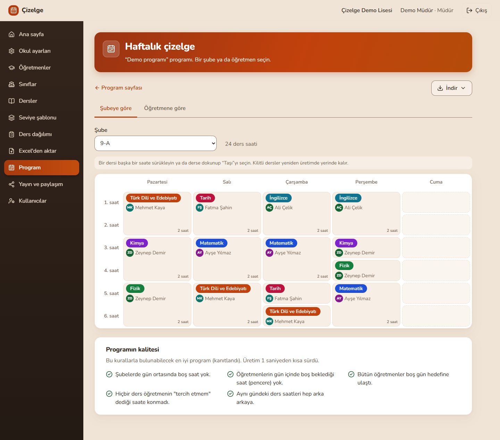
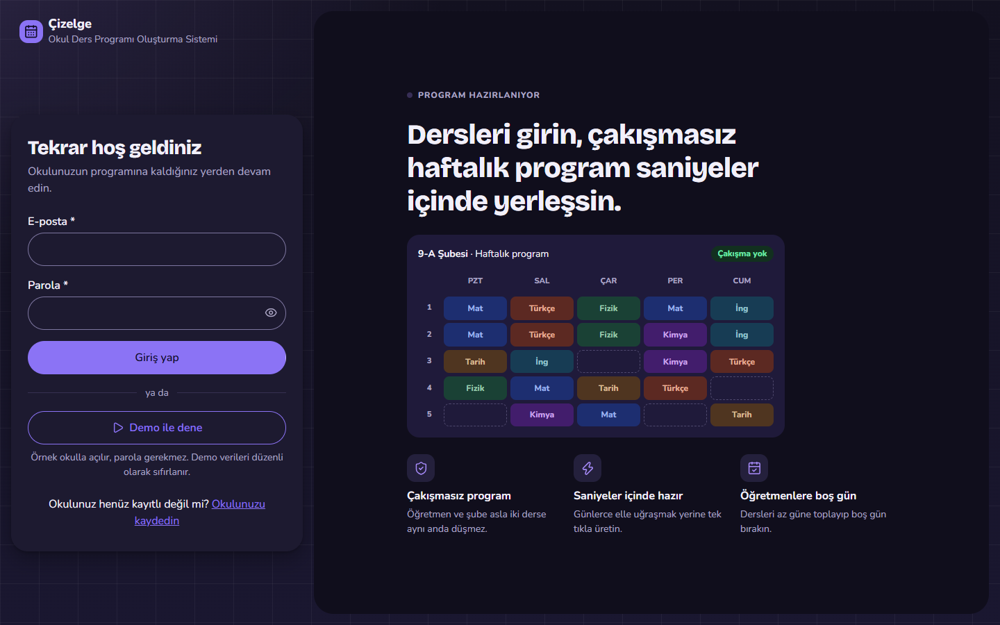

<h1 align="center">Çizelge</h1>

<p align="center">
  Okullar için çakışmasız haftalık ders programını kısıt çözücüyle üreten, çok okullu web uygulaması.
</p>

<p align="center">
  <a href="https://cizelge.pages.dev"><b>Canlı demo: cizelge.pages.dev</b></a>
</p>

<p align="center">
  
  
  
  
  
  
</p>

> **Demo:** giriş sayfasındaki **Demo ile dene** düğmesiyle parola gerekmeden, örnek bir okulla
> denenebilir. Demo verileri düzenli olarak sıfırlanır. Sunucu ücretsiz planda çalıştığı için ilk
> açılış bir dakika kadar sürebilir.

| Giriş ekranı | Ana sayfa |
|---|---|
|  |  |
| **Haftalık çizelge** | **Koyu tema** |
|  |  |

## Ne yapar

Okul yöneticisi öğretmenleri, şubeleri, dersleri ve kimin hangi şubeye hangi dersi haftada kaç saat
verdiğini girer, kuralları ayarlar. Sistem arka planda, hiçbir öğretmenin ve şubenin aynı saatte iki
yerde olmadığı bir program üretir. Yönetici sonucu görür, sürükleyip bırakarak düzeltir, yayımlar,
PDF ve Excel olarak alır.

## Özellikler

- **Çok okullu:** her okul yalnızca kendi verisini görür; izolasyon veritabanı düzeyinde de korunur.
- **Veri girişi:** öğretmen, şube, şube grubu ve ders listeleri; Excel şablonundan toplu içe aktarma.
- **Seviye şablonu:** bir seviyenin dersleri bir kez yazılır, bütün şubelere uygulanır; şubeye özel
  "almaz / ek alır" istisnaları korunur.
- **Ders dağılımı:** her derse öğretmen seçilir, öğretmen yükleri ve kapasite aşımları anında görünür.
- **Kurallar:** zorunlu kurallar (çakışma yok, müsaitlik, günlük sınırlar, blok dersler, kilitler) ve
  önemi ayarlanabilen esnek kurallar (şube boşluğu, öğretmen penceresi, boş gün, saat tercihleri).
  Kurallar derse, şubeye, gruba ya da öğretmene özel verilebilir.
- **Program üretme:** kuyruk üzerinden, durum takibiyle. Çözüm yoksa nedeni kullanıcının diliyle
  söylenir ("Ayşe Yılmaz'ın 24 saat dersi var, müsait olduğu 20 saat var").
- **En az değişiklikle güncelleme:** mevcut program temel alınır, program baştan dağılmaz.
- **Elle düzeltme:** sürükle bırak, uygun / uyarılı / yasak hedeflerin renkle ve desenle gösterimi,
  hücre kilitleme, geri alma.
- **Yayın ve paylaşım:** öğretmen ve şubelere giriş gerektirmeyen, salt okunur paylaşım linki.
- **Çıktı:** şube ve öğretmen PDF'leri, çarşaf liste, Excel.
- **Arayüz:** açık ve koyu tema, telefonda gün gün görünüm, klavyeyle tam kullanım, en az 4.5:1
  metin kontrastı, "hareketi azalt" ayarına uyan animasyonlar.

## Mimari

```
Tarayıcı (React)
     |  aynı köken: /api
     v
API (FastAPI, modüler monolit)  ---->  PostgreSQL (satır düzeyi güvenlik)
     |                                     ^
     v                                     |
Kuyruk (Redis + RQ)  ---->  Worker  ---->  Çözücü (saf Python, OR-Tools CP-SAT)
```

- **Arayüz** yalnızca API ile konuşur. Arayüz ve API tarayıcıya aynı kökenden görünür; CORS yoktur.
- **API** kimlik doğrulamayı, okul verisini ve program üretme isteklerini yönetir; çözücüyü kendisi
  çalıştırmaz. Üretim isteği kuyruğa girer, arayüz durumu birkaç saniyede bir sorar.
- **Worker** kuyruktan işi alır, veriyi okur, çözücüyü çalıştırır ve sonucu veritabanına yazar.
  Üretim dakikalar sürebildiği için API'yi bekletmez.
- **Çözücü** veritabanından ve web'den habersiz bir Python paketidir: düz veri alır, yerleşim
  listesi döner. Bir arayüzün (`ProgramCozucu`) arkasındadır ve her kural ayrı bir sınıftır
  (strategy deseni). Önce yalnızca zorunlu kurallarla bir program bulunur, sonra esnek kurallarla
  kalan sürede iyileştirilir.
- **Okul izolasyonu üç katmanlıdır:** ORM her sorguya okul koşulunu tek yerden ekler, bileşik yabancı
  anahtarlar okullar arası ilişkiyi, PostgreSQL satır düzeyi güvenliği (RLS) başka okulun satırlarını
  görmeyi engeller.
- **Kimlik doğrulama** sunucu taraflı oturumla yapılır: `HttpOnly`, `SameSite=Strict` çerez,
  argon2id parola özeti, köken denetimi.

**Canlıda:**

| Parça | Nerede |
|---|---|
| Arayüz | Cloudflare Pages. `/api` istekleri bir Pages Function ile API'ye iletilir, aynı köken korunur |
| API ve worker | Render, tek Docker servisi |
| Kuyruk | Render Key Value (Redis uyumlu) |
| Veritabanı | Neon (PostgreSQL) |

Her önemli kararın bağlamı, alternatifleri ve sonuçları [docs/adr/](docs/adr/) altında karar
kayıtları (ADR) olarak tutulur.

## Teknolojiler

| Katman | Teknoloji |
|---|---|
| Arayüz | React 19, TypeScript, Vite, TanStack Query, React Router, CSS Modules |
| API | Python, FastAPI, SQLAlchemy, Alembic |
| Veritabanı | PostgreSQL 17 (satır düzeyi güvenlik) |
| Kuyruk | Redis, RQ |
| Çözücü | Google OR-Tools (CP-SAT) |
| Test | pytest, Vitest, Testing Library, MSW, Playwright |
| Çalıştırma | Docker Compose (yerel), Cloudflare Pages, Render, Neon (canlı) |

## Yerelde çalıştırma

Gereken tek şey Docker (Docker Desktop ya da Docker Engine + Compose eklentisi).

```bash
docker compose up --build -d --wait
```

İlk derleme birkaç dakika sürer. Beş konteyner çalışır: `db`, `redis`, `api`, `worker`, `web`.
Veritabanı migration'ları API başlarken kendiliğinden uygulanır.

Örnek okulu yükleyin (veritabanındaki bütün okulları silip 24 şubelik örnek bir okul kurar):

```bash
docker compose exec -e OKULAPI_ORTAM=gelistirme api python -m okulapi ornek-okul --evet --set gercekci
```

Sonra http://localhost:5173 adresini açıp `mudur@ornek.test` / `ornek-okul-parolasi` ile giriş
yapın. Bu bilgiler yalnızca yerel örnek okul içindir.

| Adres | Ne |
|---|---|
| http://localhost:5173 | Arayüz |
| http://localhost:8000/docs | API belgeleri (Swagger) |
| http://localhost:8000/api/saglik | Sağlık kontrolü |

Port doluysa `.env.example` dosyasını `.env` adıyla kopyalayıp `WEB_PORT`, `API_PORT`, `DB_PORT`
değerlerini değiştirin. Durdurmak için `docker compose down` (veritabanını da silmek için `-v`).

## Testler

API testleri gerçek PostgreSQL'e karşı çalışır; önce yalnızca veritabanını başlatın:

```bash
docker compose up -d db
```

Çözücü (veritabanı gerekmez):

```bash
cd cozucu && python -m venv .venv && .venv/Scripts/pip install -c requirements.lock -e ".[test]" && .venv/Scripts/python -m pytest
```

API (çözücü ve worker paketleriyle birlikte):

```bash
cd api && python -m venv .venv && .venv/Scripts/pip install -c requirements.lock -e ../cozucu -e ".[test]" -e ../worker && .venv/Scripts/python -m pytest
```

Arayüz (tip denetimi, lint ve testler; API gerekmez):

```bash
cd web && npm ci && npm run denetim
```

Uçtan uca testler çalışan bütün sisteme bağlanır (sistem ayakta ve örnek okul yüklü olmalı):

```bash
cd api && .venv/Scripts/python -m pytest -m uctan_uca -s
```

```bash
cd web && npm run e2e
```

Linux ve macOS'ta `.venv/Scripts/` yerine `.venv/bin/` kullanılır.

## Klasör yapısı

```
cozucu/    Saf Python çözücü paketi (OR-Tools CP-SAT) ve testleri
api/       FastAPI uygulaması: çekirdek (okul, kullanıcı, öğretmen, şube, ders) + modüller
worker/    Kuyruk işçisi
web/       Arayüz (React + TypeScript + Vite); web/functions: Cloudflare Pages API iletimi
docker/    Konteyner başlangıç betikleri
docs/      Rapor, UML diyagramları, mimari karar kayıtları, planlar, ölçümler, ekran görüntüleri
veri/      Test veri setleri (mini, gerçekçi, büyük; adlar uydurmadır)
scripts/   Diyagram, ölçüm ve yardımcı betikler
```

## Belgeler

- [CLAUDE.md](CLAUDE.md): kapsam, mimari, veri modeli ve çözücü kuralları (projenin tek doğruluk kaynağı)
- [docs/rapor.md](docs/rapor.md): proje raporu ([PDF](docs/rapor.pdf))
- [docs/adr/](docs/adr/): mimari karar kayıtları
- [docs/diyagramlar/](docs/diyagramlar/): UML diyagramları
- [docs/olcumler.md](docs/olcumler.md): çözücünün süre ve kalite ölçümleri

## English summary

**Çizelge** is a multi-tenant web application that generates conflict-free weekly school timetables.
School administrators enter teachers, classes, subjects and teaching assignments, configure hard and
soft constraints, and the system builds a timetable in the background with Google OR-Tools (CP-SAT),
so that no teacher or class is in two places at once. Timetables can be edited by drag and drop,
locked, published through read-only share links, and exported as PDF and Excel. When no solution
exists, the system explains why in plain language.

The stack is React + TypeScript on the front end, a FastAPI modular monolith with PostgreSQL
(row-level security for tenant isolation), and a Redis/RQ worker that runs the solver outside the
API. The live demo runs on Cloudflare Pages, Render and Neon. Try it at
[cizelge.pages.dev](https://cizelge.pages.dev) with the **Demo ile dene** ("Try the demo") button, no
password needed. The UI is in Turkish.

---

Geliştiren: **Yusuf Ayçiçek** · [github.com/yusuf-aycicek](https://github.com/yusuf-aycicek)
