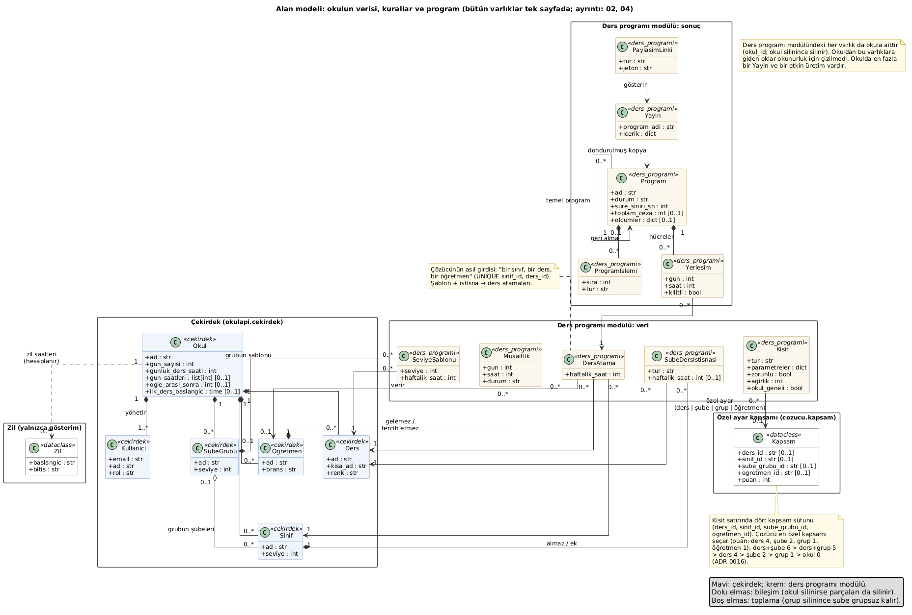
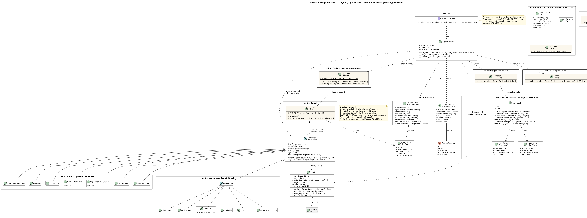
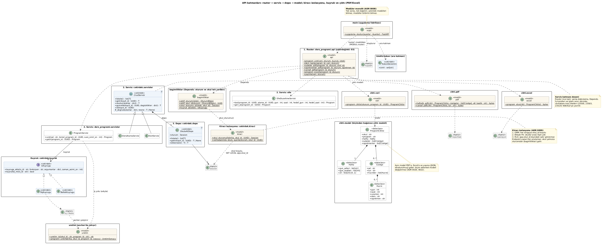
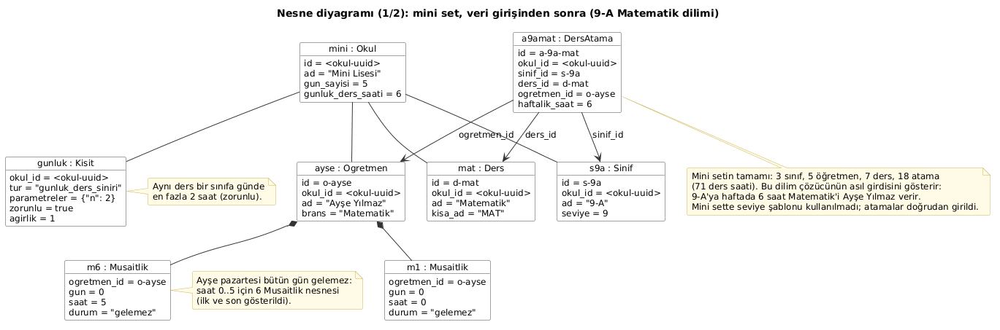
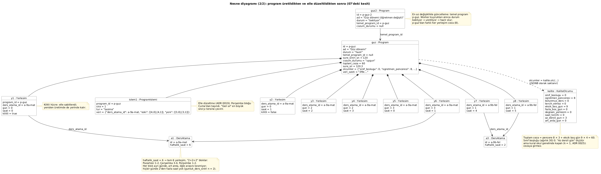
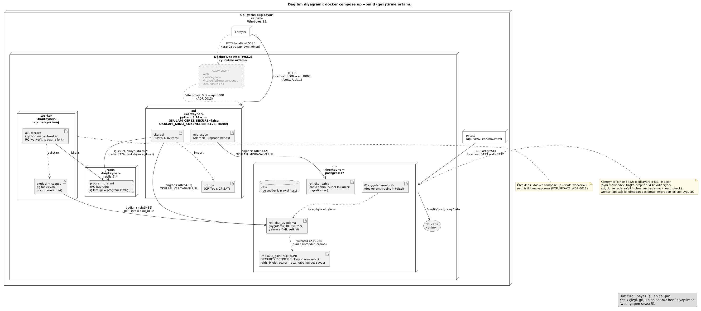

<div class="kapak">

<p class="kapak-kurum">Fırat Üniversitesi<br>Teknoloji Fakültesi<br>Yazılım Mühendisliği Bölümü</p>

<h1 class="kapak-baslik">Çizelge – Okul Ders Programı Oluşturma Sistemi</h1>

<p class="kapak-ders">Yazılım Tasarımı ve Mimarisi<br>Dönem Projesi Raporu</p>

<p class="kapak-yazar">Yusuf Ayçiçek</p>

<p class="kapak-tarih">Ekim 2026</p>

</div>

<div class="sayfa-sonu"></div>

## İçindekiler

1. Amaç ve kapsam
2. Gereksinimler
3. Mimari
4. Kullanılan desenler ve nedenleri
5. Veritabanı tasarımı
6. Çözücü
7. Diyagramlar
8. Test stratejisi
9. Ölçümler ve ölçüme dayalı kararlar
10. Önemli mimari kararların özeti
11. Sınırlar ve gelecek çalışmalar

<div class="sayfa-sonu"></div>

## 1. Amaç ve kapsam

Ortaokul ve liselerde haftalık ders programı çoğunlukla elle ya da tek bir okul için yazılmış
masaüstü programlarla hazırlanır. Sorun küçük görünür ama birbirine bağlı çok sayıda kural
içerir: bir öğretmen aynı saatte iki sınıfta olamaz, başka okulda da görevli öğretmen bazı günler
gelemez, aynı ders bir sınıfa günde ikiden fazla konmaz, iki saatlik dersler art arda olmalıdır,
sınıfın gün ortasında boş saati kalmamalıdır, öğretmenler mümkünse haftada bir gün boş olmak ister.
Bir öğretmenin değişmesi bütün programı yeniden yazmayı gerektirmemelidir.

**Çizelge**, bu işi bir web uygulaması olarak yapar. Okul yöneticisi öğretmenleri, şubeleri,
dersleri ve kimin hangi şubeye hangi dersi haftada kaç saat verdiğini girer, kuralları ayarlar.
Sistem arka planda, zorunlu kuralların hiçbirini bozmayan ve esnek kuralların ağırlıklı cezasını
en aza indiren bir program üretir. Yönetici sonucu şube ve öğretmen bazında görür, sürükleyip
bırakarak düzeltir, programı yayımlar, PDF ve Excel olarak alır.

Proje belirli bir okul için değil, **birden fazla okulun birbirinden bağımsız kullanabileceği genel
bir sistem** (çok kiracılı, multi-tenant) olarak tasarlandı. Okuldan okula değişen her şey (gün
sayısı, günlere göre ders saati, öğle arası, günlük sınırlar, blok dersler, kuralların önemi)
ayarlanabilir; okul hiçbir şey girmese de makul varsayılanlarla çalışır.

**Kapsamda olanlar:** okul kaydı ve yönetici girişi; okul ayarları; öğretmen, şube, şube grubu ve
ders listeleri (elle ve Excel'den); seviye şablonu ve şubeye özel istisnalar; ders atama;
öğretmen müsaitliği; zorunlu ve esnek kurallar ile derse, şubeye, gruba ya da öğretmene özel
ayarlar; kuyruk üzerinden program üretme ve durum takibi; çözülemezlik açıklaması; en az
değişiklikle güncelleme; elle düzeltme (taşıma, yer değiştirme, kilitleme, geri alma); PDF ve
Excel çıktısı; yayın ve öğretmenlere girişsiz paylaşım linki.

**Bilerek kapsam dışında bırakılanlar:** mekan (laboratuvar, spor salonu) çakışması; bölünen ya da
birleşen şubeler ve bir derse birden fazla öğretmen. Model kalıcı olarak "bir sınıf, bir ders, bir
öğretmen"dir. Dönem/yıl yönetimi, ikili öğretim ve öğretmen hesapları ilk sürümde yoktur ama model
bunlara açık bırakıldı.

Proje 6–24 Ekim 2026 arasında, her adımın sonunda çalışan ve test edilen bir parça olacak şekilde
sekiz adımda yapıldı (113 commit). Kod büyüklüğü: çözücü yaklaşık 4.000, API 8.900, arayüz 14.500
satır; Python testleri 10.500, arayüz testleri 4.500 satır.

## 2. Gereksinimler

### 2.1 İşlevsel gereksinimler

| No | Gereksinim | Karşılandığı yer |
|---|---|---|
| G1 | Okul kaydı, yönetici girişi, müdür/müdür yardımcısı rolleri | Kimlik modülü, ADR 0012 |
| G2 | Okul ayarları: gün sayısı, günlük ders saati, günlere göre saat, öğle arası, zil saatleri | `okul` tablosu, Okul ayarları sayfası |
| G3 | Öğretmen, şube, şube grubu, ders listeleri; Excel'den içe aktarma | Çekirdek CRUD, ADR 0021 |
| G4 | Seviye/grup şablonu; şubeye özel "almaz / ek" istisnası | `seviye_sablonu`, `sube_ders_istisnasi` |
| G5 | Ders atama: şube görünümü ve öğretmen yükü görünümü | Ders dağılımı sayfası, ADR 0015 |
| G6 | Öğretmen müsaitliği: gelemez (zorunlu), tercih etmez (esnek) | `musaitlik` |
| G7 | Zorunlu ve esnek kurallar; kuralların okul geneli ve özel ayarları | `kisit`, ADR 0016 |
| G8 | Program üretme kuyrukta, durum takibiyle | ADR 0011 |
| G9 | Çözüm yoksa nedenin kullanıcının diliyle açıklanması | Ön kontrol + çelişki analizi, ADR 0005 |
| G10 | Mevcut programı temel alarak en az değişiklikle güncelleme | ADR 0006 |
| G11 | Elle düzeltme: taşıma, yer değiştirme, çakışma uyarısı, kilit, geri alma | ADR 0019 |
| G12 | PDF ve Excel çıktısı | ADR 0020 |
| G13 | Yayın ve öğretmene girişsiz paylaşım linki | ADR 0022 |

### 2.2 İşlevsel olmayan gereksinimler

| Nitelik | Gereksinim | Nasıl sağlandı, nasıl kanıtlandı |
|---|---|---|
| Güvenlik / izolasyon | Bir okul diğerinin verisini hiçbir yoldan göremez | ORM filtresi + bileşik FK + RLS; izolasyon testleri, bağlantı havuzu taşma testi |
| Yanıt verebilirlik | Uzun süren üretim diğer kullanıcıları bekletmez | Çözücü worker'da; API yalnızca kuyruğa koyar |
| Ölçeklenebilirlik | Dönem başı yoğunluğunda sistem çökmez | Kuyruk; `docker compose up --scale worker=N`; okul başına tek etkin üretim |
| Değiştirilebilirlik | Yeni kural ya da algoritma mevcut kodu değiştirmeden eklenir | Strategy deseni, `ProgramCozucu` arayüzü |
| Genişletilebilirlik | Yeni modül (ör. ders notları) çekirdeği değiştirmez | Modüler monolit, modül sözleşmesi |
| Kalite | Gerçekçi okulda 120 sn içinde sınıf boşluğu sıfır | Ölçüm (bölüm 9) |
| Kullanılabilirlik | Hata mesajları kimlik değil ad kullanır; telefonda da çalışır | Ön kontrol mesajları; Playwright telefon projesi, taşma denetimi |
| Erişilebilirlik | Metin kontrastı en az 4,5:1 | Kontrast testi (WCAG 2.2) |
| Taşınabilirlik | Tek komutla kurulum | Docker Compose |

## 3. Mimari

### 3.1 Genel yapı

Sistem dört çalışan parça ve bir veritabanından oluşur:

```
Tarayıcı (React)
     |  aynı köken (/api)
     v
API (FastAPI)  ---->  PostgreSQL
     |                    ^
     v                    |
Kuyruk (Redis)  ---->  Worker (Python)  -->  Çözücü modülü (OR-Tools CP-SAT)
```

- **Web arayüzü** (React, TypeScript, Vite) yalnızca API ile konuşur.
- **API** (FastAPI, SQLAlchemy, Alembic) kimlik doğrulamayı, okul verisinin yönetimini ve program
  üretme isteklerinin kuyruğa atılmasını yapar. **Çözücüyü kendisi çalıştırmaz.**
- **Kuyruk** (Redis + RQ) program üretme işlerini sıraya koyar.
- **Worker** kuyruktan iş alır, veriyi okur, çözücüyü çalıştırır, sonucu veritabanına yazar.
- **Çözücü** veritabanından ve web'den habersiz, saf bir Python paketidir: girdi olarak düz veri
  yapıları (`CozumGirdisi`) alır, yerleşim listesi (`CozumSonucu`) döner.

Temel gerekçe, işin doğasındaki asimetridir: bir program üretmek saniyelerden dakikalara kadar
sürer ve işlemciyi tüketir; diğer bütün istekler milisaniyeler sürer. Çözücü API sürecinde
çalışsaydı, dönem başında birkaç okul aynı anda program üretirken diğer okulların sayfaları
açılmazdı. Kuyruk bu yükü sıraya koyar; gerekirse worker sayısı artırılır.

### 3.2 Modüler monolit

API tek bir süreç ve tek bir dağıtım birimidir, ama içi **çekirdek** ve **modüller** olarak
ayrılmıştır (ADR 0008):

- **Çekirdek** (`okulapi.cekirdek`): okul, kullanıcı, oturum, öğretmen, şube, şube grubu, ders;
  okul izolasyonu, depo ve servis temel sınıfları, kuyruk arayüzü, modül sözleşmesi.
- **Ders programı modülü** (`okulapi.moduller.ders_programi`): şablon, istisna, atama, müsaitlik,
  kural, program, yerleşim, elle düzeltme, çıktı, içe aktarma, yayın, paylaşım.

Bağımlılık kuralı: modül çekirdeğe bağımlı olabilir, **çekirdek modülleri bilmez**, modüller
birbirini doğrudan kullanmaz. Her modül paketinde bir `MODUL` nesnesi (router, migration dizini,
modeller, isteğe bağlı kancalar) tanımlar; çekirdek modülleri ayardaki adlarıyla yükler, kaynak
kodunda içe aktarmaz. Çekirdeğin bir işi modül verisini etkilediğinde (ör. okulun gün sayısı
azalınca o günlere konmuş müsaitlik kayıtları) çekirdek modüle bir kancayla sorar (ADR 0014). Bu
kurallar iki testle denetlenir (`test_cekirdek_modulleri_ice_aktarmaz`,
`test_moduller_birbirini_ice_aktarmaz`). Migration'lar da modül başına ayrı Alembic dalıdır
(ADR 0010): ileride "ders notları" modülü eklendiğinde çekirdeğin migration'ları değişmez.

Değerlendirilen alternatif mikroservislerdi. Tek geliştiricili, tek veritabanlı ve okul başına
küçük veri hacimli bir sistemde ağ çağrıları, dağıtık işlem ve ayrı dağıtım boru hatları maliyet
getirir ama karşılığında bir şey kazandırmaz. Modüler monolit, mikroservise geçişi gerekirse
mümkün kılacak sınırları bugünden çizer.

### 3.3 Katmanlar

Bir istek API'de şu katmanlardan geçer (diyagram 12, 03):

1. **Router** (FastAPI): HTTP ile şema arasındaki çeviri ve bağımlılık enjeksiyonu (`Depends`).
   Router ince tutulur; iş kuralı içermez.
2. **Servis**: iş kuralları ve işlem (transaction) sınırı. Ortak CRUD davranışı genel
   `CrudServisi<T>` sınıfındadır; alt sınıflar yalnızca `_dogrula` kancasını doldurur. Veritabanı
   kısıt ihlalleri (SQLSTATE 23505, 23503, 23514) servis istisnalarına, onlar da merkezi olarak
   404/409/422 yanıtlarına çevrilir.
3. **Depo**: veri erişimi. `OkulaAitDepo<T>` her sorguyu oturumun okuluna göre yapar.
4. **Model**: SQLAlchemy tabloları.

### 3.4 Kiracı (okul) izolasyonu

Çok kiracılı yapı **satır düzeyindedir**: her tabloda `okul_id` vardır. Ayrı veritabanı ya da
şema yerine bu yol seçildi, çünkü okul sayısı çok, okul başına veri azdır ve migration'lar tek
şemaya bir kez uygulanır. Riski açıktır: tek bir unutulmuş `WHERE okul_id = ...` bir okulun
verisini başka okula gösterir. Bu yüzden izolasyon **üç bağımsız katmanda** uygulanır (ADR 0009):

1. **ORM filtresi, tek yerde.** `cekirdek/kiraci.py`, SQLAlchemy olaylarıyla her sorguya okul
   koşulunu (`with_loader_criteria`) ekler, yeni kayda `okul_id` yazar, başka okula yazmayı ya da
   kaydı başka okula taşımayı reddeder. Okul yalnızca oturumdan gelir (`bagimliliklar.py`);
   endpoint yazan kişinin unutabileceği bir adım yoktur.
2. **Bileşik yabancı anahtarlar.** Her okula ait tabloda `UNIQUE (okul_id, id)` vardır; ilişkiler
   `(okul_id, x_id) → x(okul_id, id)` biçimindedir. Uygulamada bir hata olsa bile bir okulun ders
   ataması başka okulun öğretmenini gösteremez.
3. **PostgreSQL satır düzeyi güvenliği (RLS).** Uygulama tabloların sahibi olmayan `okul_uygulama`
   rolüyle bağlanır; her işlemin başında `SET LOCAL app.okul_id` yazılır, politikalar yalnızca o
   okulun satırlarını gösterir. `SET LOCAL` işlem bitince silindiği için bağlantı havuzunda aynı
   bağlantı art arda farklı okullar için kullanıldığında okul bilgisi taşmaz; bu bir testle
   kanıtlanmıştır.

Girişte okul henüz bilinmez. Kullanıcı ve oturum, RLS altında, `NOLOGIN` bir rolün (`okul_giris`)
sahibi olduğu dar kapsamlı `SECURITY DEFINER` fonksiyonlarla aranır (ADR 0012). Paylaşım linkleri
de aynı yolla, ayrı bir rolün (`okul_paylasim`) fonksiyonuyla okunur.

### 3.5 Kuyruk ve worker

Program üretme isteği (`POST /api/ders-programi/programlar`) `bekliyor` durumunda bir program kaydı
oluşturur, işi kuyruğa koyar ve hemen 202 döner (ADR 0011). Arayüz durumu birkaç saniyede bir sorar
(polling); WebSocket bu ölçek için gereksiz karmaşıklık olarak değerlendirildi. Worker işi alınca
üç ayrı veritabanı işlemi yapar: (1) programı `FOR UPDATE` ile kilitleyip `uretiliyor` yapar ve
girdinin özetini alır; (2) **veritabanı bağlantısı olmadan** çözer; (3) yeniden kilitler, verinin
bu arada değişip değişmediğine bakar, sonucu bağımsız doğrulayıcıdan geçirir, yerleşimleri yazar.
İş kimliği program kimliğidir; aynı iş iki worker'da çalışmaz. Okul başına en fazla bir etkin
üretim, kısmi benzersiz indeksle veritabanında da korunur.

Worker hiçbir modülü içe aktarmaz: işi Python yoluyla adından çalıştırır. Kuyruk `IsKuyrugu`
arayüzünün arkasındadır; testlerde bellek içi ikiz (`BellekKuyrugu`), RQ gerçeklemesi fakeredis
ile sınanır.

### 3.6 Kimlik doğrulama

Sunucu taraflı oturum kullanılır (ADR 0012): rastgele jeton `HttpOnly`, `SameSite=Strict` bir
çerezde taşınır; veritabanında yalnızca SHA-256 özeti saklanır. Parola özeti argon2id'dir. Oturum
hem hareketsizlik hem mutlak süreyle sınırlıdır; hatalı girişler e-posta başına sayılır. Arayüz ile
API tarayıcıya hep **aynı kökenden** görünür (geliştirmede Vite proxy'si, yayında ters vekil
sunucu); bu yüzden CORS yoktur ve veri değiştiren isteklerde `Origin` başlığı denetlenir
(ADR 0013). JWT değerlendirildi; oturumu sunucudan anında iptal edememesi (parola değişince bütün
oturumları kapatmak gibi) ve çerezde saklanınca da CSRF korumasını gerektirmesi yüzünden seçilmedi.

## 4. Kullanılan desenler ve nedenleri

| Desen | Nerede | Neden |
|---|---|---|
| **Strategy** | Her kural `KisitKurali`'ndan türeyen ayrı bir sınıf; `CpSatCozucu` hepsine `uygula(baglam)` der (ADR 0002) | Yeni kural eklemek mevcut kodu değiştirmez (açık/kapalı prensibi). Bugün 19 somut kural vardır; kural eklemek çözücü sınıfında değişiklik gerektirmez |
| **Kayıt defteri (registry)** | `@kaydet` dekoratörü, `KAYIT_DEFTERI` (tür adı → sınıf) | API ve çözücü aynı kural listesini bilir; çözücüye kural eklenince API'de değişiklik gerekmez |
| **Arayüz arkasında algoritma (bağımlılığın tersine çevrilmesi)** | `ProgramCozucu` → `CpSatCozucu`; `IsKuyrugu` → `RqKuyrugu`, `BellekKuyrugu` | Worker yalnızca arayüzü bilir; CP-SAT yerine başka bir algoritma ya da kuyruk yeni bir gerçeklemedir. Testler gerçek Redis'e ihtiyaç duymaz |
| **Servis katmanı** | `CrudServisi<T>` ve modül servisleri | İş kuralı ve işlem sınırı tek yerde; router ince kalır, aynı kural içe aktarmada da uygulanır |
| **Şablon metot** | `CrudServisi._dogrula` kancası | Ortak CRUD akışı bir kez yazılır, alt sınıf yalnızca kendi doğrulamasını ekler |
| **Depo (repository)** | `OkulaAitDepo<T>` | Okul filtresi ve veri erişimi tek yerde |
| **Modüler monolit + eklenti sözleşmesi** | `Modul` dataclass'ı, `MODUL` nesnesi, kancalar | Çekirdek modülleri bilmeden yükler; yeni modül çekirdeği değiştirmez |
| **Düz veri aktarım nesnesi (DTO)** | `CozumGirdisi`, `CozumSonucu` (dataclass, JSON) (ADR 0003) | Çözücü veritabanından habersiz; komut satırından, testlerden ve worker'dan aynı girdiyle çalışır |
| **Komut + geri alma** | Her elle düzeltme bir `ProgramIslemi` kaydı (ADR 0019) | Geri alma son işlemi tersine çevirir; geçmiş veritabanında durduğu için sayfa yenilense de kaybolmaz |
| **Anlık görüntü** | `Yayin.icerik`: yayın anındaki çıktı modeli (ADR 0022) | Yayınlanan program, veri değişse de sessizce değişmez |
| **Ortak çıktı modeli** | `ProgramCiktisi` → PDF, Excel, yayın JSON'u (ADR 0020) | Biçim eklemek modeli değiştirmez; üç çıktı aynı veriyi gösterir |

Strategy deseninin bu projedeki asıl getirisi ölçülebilir: ilk adımdaki kurallardan sonra çözücüye
blok dersler, haftalık yük eşiği, dersin saat tercihi, günde en az ders ve günlere yayılım
kuralları sonradan eklendi; her biri yeni bir sınıf ve `@kaydet` satırıydı. Kural listesi kayıt
defterinden okunduğu için API'nin kural uçları ve `CpSatCozucu`'nun kuralları uygulayan döngüsü bu
yüzden değişmek zorunda kalmadı.

## 5. Veritabanı tasarımı

PostgreSQL 17 kullanılır; 18 tablo vardır (diyagram 11, 02, 04). Alan terimleri Türkçe ve ASCII
yazılır (`ogretmen`, `ders_atama`): kullanıcının diliyle kod aynı kalır.

**Çekirdek:** `okul` (kök; gün sayısı, günlük ve günlere göre ders saati, öğle arası, zil
ayarları), `kullanici`, `oturum`, `giris_denemesi` (okula ait olmayan tek tablo: kaba kuvvet
sayacı), `ogretmen`, `sube_grubu`, `sinif`, `ders`.

**Ders programı modülü:** `seviye_sablonu`, `sube_ders_istisnasi`, `ders_atama` (çözücünün asıl
girdisi), `musaitlik`, `kisit`, `program`, `yerlesim`, `program_islemi`, `yayin`,
`paylasim_linki`.

Tasarımın öne çıkan kararları:

- **Kimlikler uuid'dir;** okula ait her tabloda `UNIQUE (okul_id, id)` ve bileşik yabancı
  anahtarlar vardır (bölüm 3.4).
- **İş kuralları veritabanında da korunur.** "Bir sınıf, bir ders, bir öğretmen" →
  `UNIQUE (okul_id, sinif_id, ders_id)`. Programın durum makinesi CHECK kısıtlarıyla korunur
  (`hazir` programın geçerli bir çözüm durumu ve bitiş zamanı olmak zorundadır). "Okulda tek etkin
  üretim" kısmi benzersiz indekstir: aynı anda gelen iki istekten ikincisi 409 alır. Kuralın
  kapsamı için `UNIQUE NULLS NOT DISTINCT (okul_id, tur, ders_id, sinif_id, sube_grubu_id,
  ogretmen_id)` ve "öğretmen kapsamı ders/şube ile birleşmez" CHECK'i vardır.
- **Silme davranışı anlamla eşleşir.** Parça bütünle silinir (`CASCADE`: programın yerleşimleri,
  öğretmenin müsaitliği, varlığa özel ayar); kullanılan çekirdek kaydı silinemez (`RESTRICT`:
  dersi atanmış öğretmen); bağlantı koparılır (`SET NULL (sutun)`: grup silinince şube grupsuz
  kalır). PostgreSQL 15+'ın sütun listeli `SET NULL` özelliği, bileşik anahtarda `okul_id`'ye
  dokunmadan yalnızca grup sütununu boşaltmak için kullanıldı.
- **Esnek yapılı alanlar JSONB'dir:** kural parametreleri (`{"n": 2}`), kalite ölçüleri,
  çelişkiler, elle düzeltme işleminin verisi, yayının içeriği.
- **Kurallar tek tabloda.** Okul geneli kural ile derse, şubeye, gruba ya da öğretmene özel ayar
  aynı `kisit` tablosudur; kapsam sütunlarının hepsi boşsa okul genelidir. Çözücü "en özel kapsam
  kazanır" kuralıyla tek yerden çözümler (ADR 0016).
- **Program yeniden üretilebilir ve karşılaştırılabilirdir.** `girdi_ozeti` (çözücü girdisinin
  SHA-256'sı) üretim sırasında veri değişti mi sorusunu, `veri_ozeti` "bu program eski verilerle mi
  üretildi" sorusunu yanıtlar.
- **Roller en az yetkiyle ayrılır:** `okul_sahip` (tablo sahibi, migration'lar), `okul_uygulama`
  (yalnızca DML, RLS'ye tabi), `okul_giris` ve `okul_paylasim` (`NOLOGIN`, yalnızca kendi
  fonksiyonları).

## 6. Çözücü

### 6.1 Model

Çözücü Google OR-Tools'un CP-SAT kısıt programlama çözücüsünü kullanır (ADR 0001). Tamsayılı
doğrusal programlama (PuLP + CBC), sezgisel/genetik algoritmalar ve hazır yazılımlar (FET, aSc)
değerlendirildi; CP-SAT, "en az bir / en çok bir" türü mantıksal kısıtlarda güçlü olması, çok
çekirdekli araması, süre sınırında bulduğu en iyi çözümü vermesi ve çözümsüzlüğü kanıtlayabilmesi
nedeniyle seçildi. Sezgisel yöntemler zorunlu kısıtların sağlandığını garanti etmez. Model, her (ders ataması, gün, saat) üçlüsü için bir boolean
değişkendir: "bu atama bu saatte yapılıyor mu". Gerçekçi sette bu 330 atama × 5 gün × 8 saat
yaklaşık 13.000 değişkendir.

### 6.2 Zorunlu kurallar

Her atama tam haftalık saati kadar yerleşir; bir şube ve bir öğretmen aynı saatte en fazla bir
derstedir; "gelemez" saatlere ders konmaz; kilitli hücreler yerinde kalır; aynı ders bir şubeye
günde en fazla N (varsayılan 2) saat konur; bir öğretmen günde en fazla M (varsayılan 8) saat derse
girer; kısa günlerde günün sonu kullanılmaz. **Blok dersler** (ADR 0017): dersin haftalık saati
"2+2+1" gibi bloklara bölünür; her blok ayrı bir günde, art arda ve öğle arasını kesmeden yerleşir.
Okulun önerisi (5 saat → 2+2+1) uygulanamayan atamada düşer; açıkça seçilen şekil düşmez, ön kontrol
nedenini söyler. Öğretmenin haftalık yük eşikleri (ADR 0023) modele bir şey eklemeyen bir "uyarı
kuralı"dır.

### 6.3 Esnek kurallar

Her esnek kural ağırlıklı bir ceza terimi döner; toplam ceza en aza indirilir (ADR 0004). Her ceza
terimi amaca tek, negatif olamayan bir değişken olarak girer (ADR 0007). Varsayılan ağırlıklar:
sınıf boşluğu 30, en az değişiklik 8, tercih etmez 5, öğretmene boş gün 4, öğretmen penceresi 3,
dersin saat tercihi 3, öğretmenin geldiği günde en az ders 3, aynı dersin günlere yayılması 2,
bölünmüş ders 2. Okul her birini "Önemsiz / Önemli / Çok önemli" seçerek ya da 0 vererek kapatarak
ayarlar. Sınıf boşluğunun ağırlığı diğer bütün esnek kurallardan baskın seçildi: gün ortasında boş
kalan sınıf okullar için kabul edilemezdir.

Öğretmene boş gün kuralı "en fazla sıkıştırma" değil **hedefe ulaşma** olarak tanımlandı: hedef gün
sayısı = max(yükün sığdığı en az gün, gün sayısı − hedef boş gün); hedefe ulaşan öğretmen daha
fazla sıkıştırılmaz, yükü ya da müsaitliği yüzünden hedefi imkânsız olan öğretmene ceza yazılmaz.

### 6.4 İki aşamalı çözüm

Çözüm iki aşamalıdır (ADR 0018). Önce yalnızca zorunlu kısıtlarla, amaç fonksiyonu olmadan, ilk
programı bulunca durarak bir program aranır. Sonra bu program tam başlangıç ipucu olarak verilir ve
esnek kurallarla kalan sürede iyileştirilir. İlk aşama çözümsüzlüğü kanıtlarsa doğrudan çelişki
analizine geçilir; ikinci aşama daha iyisini bulamazsa ilk aşamanın programı döner. Gerekçe ölçümdür
(bölüm 9): ilk program daha erken gelir, kısa süre sınırlarında "program yok" durumu ortadan kalkar.

### 6.5 Ön kontrol ve çelişki analizi

Çözücü çağrılmadan önce **ön kontroller** hızlı ve anlaşılır hatalar verir: öğretmeni seçilmemiş
atama, şubenin toplam saatinin haftalık kapasiteyi aşması, öğretmenin toplam saatinin müsait
saatlerinden fazla olması (her gün için müsait saat ile M'nin küçüğü sayılır), şubenin derslerinin
öğretmenlerinin müsait olduğu saatlere sığmaması. Mesajlar kimlik değil ad kullanır:

> 9-A'nın haftada 40 saat dersi var, ama öğretmenlerinden en az birinin gelebildiği yalnızca 39
> saat var. Şu saatlerde öğretmenlerinin hiçbiri gelemiyor: Pazartesi 1. saat.

Ön kontrolden geçip çözüm yine yoksa **çelişki analizi** (ADR 0005), zorunlu kısıtları
varsayım (assumption) değişkenlerine bağlayıp çözümsüzlük çekirdeğini küçülterek çelişen kural
gruplarını bulur ve kullanıcının diliyle açıklar. Süre içinde ne çözüm ne çözümsüzlük kanıtı
bulunursa yalnızca zorunlu kısıtlarla ikinci bir kontrol yapılır; çözüm varsa "süre yetmedi" denir
ve arayüz tek tıkla daha uzun süreyle yeniden denemeyi önerir.

### 6.6 En az değişiklikle güncelleme ve elle düzeltme

Temel bir program verilirse, temel programdaki her yerleşim yeni programda yoksa ceza (8) yazılır
ve temel program başlangıç ipucu olur (ADR 0006): bir öğretmen değişince program baştan dağılmaz.
Elle düzeltmede (ADR 0019) her hedef hücre, çözücünün kendisinden bağımsız doğrulayıcıyla
değerlendirilir: uygun, uyarılı (esnek kural bozulur) ya da engelli (zorunlu kural bozulur). Hedefte
aynı şubenin dersi varsa ikisi yer değiştirir; kilitli hücre bir bloğun parçası sayılır.

### 6.7 Bağımsız doğrulama ve kalite

`dogrulama` ve `kalite` modülleri çözücünün kodunu (`cpsat`, `kisitlar`) kullanmaz: bütün zorunlu
kuralları ve esnek ölçüleri yerleşim listesinden yeniden hesaplar. Worker her sonucu kaydetmeden
önce doğrulayıcıdan geçirir; ölçümlerdeki "gerçek ceza" da modelin kendi değeri değil, bu bağımsız
ölçülerin ağırlıklı toplamıdır. Böylece modelde yanlış kurulmuş bir kısıt sessiz kalmaz.

## 7. Diyagramlar

Diyagramlar PlantUML ile yazıldı, kaynakları `docs/diyagramlar/*.puml`, çıktıları PNG ve SVG
olarak `docs/diyagramlar/cikti/` altındadır; hepsi A3 yatay sayfalarda `docs/diyagramlar/diyagramlar.pdf`
dosyasında toplanmıştır (her sayfada açıklamasıyla). **Diyagramlar kodla otomatik denetlenir:**
`api/tests/test_diyagramlar.py` her sınıf diyagramındaki sınıf, alan, metot ve parametre adlarının
kodda gerçekten var olduğunu, nesne diyagramlarındaki her alanın hem kodda hem sınıf diyagramında
bulunduğunu denetler (217 denetim). Kod değişip diyagram değişmezse test kırılır.

| No | Tür | İçerik |
|---|---|---|
| 11 | Sınıf | Alan modeli: bütün varlıklar, ilişkiler, çokluklar |
| 02, 04 | Sınıf | Çekirdek ve ders programı tabloları; okul izolasyonu |
| 06 | Sınıf | Çözücü: `ProgramCozucu`, `CpSatCozucu`, kural hiyerarşisi (strategy), doğrulama, kalite, ön kontrol, çelişki |
| 12, 03, 05 | Sınıf | API katmanları, servis katmanı, kiracı izolasyonu, kuyruk, çıktı; modül sözleşmesi |
| 10 | Sınıf | Kimlik doğrulama |
| 01 | Paket | Genel bakış ve bağımlılık yönleri |
| 07, 08 | Nesne | Örnek okuldan kesit; program, yerleşimler, kalite özeti |
| 09 | Dağıtım | Docker Compose: konteynerler, portlar, protokoller, veritabanı rolleri |

<div class="sayfa-sonu"></div>

### 7.1 Alan modeli (sınıf diyagramı)



Okulun bütün verisi: çekirdekteki okul, kullanıcı, öğretmen, şube, grup ve ders; modüldeki şablon,
istisna, atama, müsaitlik, kural (özel ayar ve kapsamı), program, yerleşim, elle düzeltme işlemi,
yayın ve paylaşım linki. Her (şube, ders) çifti için tek ders ataması vardır; kural, kapsamıyla
ders, şube, grup ya da öğretmene bağlanır.

<div class="sayfa-sonu"></div>

### 7.2 Çözücü (sınıf diyagramı)



`ProgramCozucu` arayüzü ve `CpSatCozucu` gerçeklemesi; 10 zorunlu (biri uyarı kuralı) ve 9 esnek
kural `KisitKurali` hiyerarşisindedir. Ön kontrol, çelişki analizi, doğrulama ve kalite ayrı
modüllerdir.

<div class="sayfa-sonu"></div>

### 7.3 API katmanları, kuyruk ve çıktı (sınıf diyagramı)



Router → servis → depo → model; okul yalnızca oturumdan gelir ve `kiraci` her sorguya uygulanır.
Üretim `IsKuyrugu` üzerinden worker'a gider; PDF, Excel ve yayın tek bir çıktı modelinden üretilir.

<div class="sayfa-sonu"></div>

### 7.4 Nesne diyagramları



9-A ve 9-B şubeleri, iki (uydurma) öğretmen, 9. seviye şablonu ve "9-A Felsefe almaz" istisnası:
şablon uygulanınca yalnızca 9-B'nin Felsefe ataması açılır. Öğretmene özel günlük sınır ve derse
özel blok şekli, kapsamı dolu `Kisit` nesneleridir.



Hazır program, 9-A Matematik'in "2+2+2" bloklu altı yerleşimi (biri kilitli), geri alınabilir bir
taşıma işlemi ve kalite özeti (gerçekçi setin 120 sn'lik bir ölçümü: toplam ceza 60).

<div class="sayfa-sonu"></div>

### 7.5 Dağıtım diyagramı



Beş konteyner (web, api, worker, redis, db). Tarayıcı yalnızca web kökenini görür, Vite `/api`
isteklerini api'ye iletir. Redis dışarıya port açmaz. Uygulama ve worker RLS'ye tabi rolle,
migration'lar tablo sahibi rolle bağlanır. Yayında web derlenip ters vekil sunucunun arkasına HTTPS
ile konur.

<div class="sayfa-sonu"></div>

## 8. Test stratejisi

Kural: her özellik için test yazılır, testler geçmeden iş bitmiş sayılmaz. Test komutlarının
başarısı çıktının son satırından değil, **komutun kendi çıkış kodundan** denetlenir; çıktıyı başka
bir komuta borulamak başarısızlığı gizleyebildiği için yasaktır (bu kural, başarısız bir testin iki
kez commit edilmesinden sonra eklendi).

| Katman | Araç | Ne sınanır | Sayı |
|---|---|---|---|
| Çözücü birim ve senaryo | pytest | Her kural ayrı ayrı; mini set uçtan uca; ön kontrol, çelişki, blok, kapsam, taşıma; her çözüm bağımsız doğrulayıcıdan geçer | 296 (+3 uzun ölçüm, `-m slow`) |
| API entegrasyon | pytest + gerçek PostgreSQL | Endpoint'ler, servisler, migration'lar, veritabanı kısıtları, RLS, kimlik, kuyruk (bellek ikizi ve fakeredis), çıktı, diyagram-kod tutarlılığı | 731 (+2 uçtan uca, `-m uctan_uca`) |
| Arayüz bileşen | Vitest + Testing Library + MSW | Sayfalar ve bileşenler sahte API'ye karşı; renk kontrastı | 363 |
| Uçtan uca (API) | pytest, çalışan sistem | Kuyruk akışı `bekliyor → uretiliyor → hazir`; kayıt/giriş; `X-Okul-Id` başlığının yok sayılması; köken denetimi | 2 |
| Uçtan uca (tarayıcı) | Playwright + Edge, masaüstü ve telefon | Giriş, müsaitlik ve boş gün hedefi, program üretme, çizelgede sonucun görünmesi; test dokunduğu veriyi geri alır | 1 senaryo × 2 boyut |
| Tip ve lint | TypeScript, ESLint | Arayüzün tamamı; API şeması değişince arayüz tipleri yenilenmezse test kırılır | — |

**İzolasyon testleri.** İki okul oluşturulur; biri diğerinin verisini ne listeleyebilir, ne
getirebilir, ne değiştirebilir, ne de kendi kaydını öbürüne bağlayabilir. ORM filtresi atlansa bile
RLS'nin satırları gizlediği ve bileşik yabancı anahtarın okullar arası ilişkiyi reddettiği ayrıca
sınanır. **Taşma testi:** aynı veritabanı bağlantısı art arda farklı okullar için kullanıldığında
okul bilgisinin bir istekten diğerine taşmadığı kanıtlanır.

**Mutasyon denemesi.** Kritik yerlerde (çözücü, veritabanı kısıtları, okul izolasyonu, kimlik
doğrulama) kod bilerek bozulup testlerin yakaladığı denetlendi. Kayıtlı sonuçlardan örnekler:
iki aşamalı çözümde çözücü 8/8, arayüz 5/5; şube grupları ve istisnalarda API 15/15, çözücü 1/1,
arayüz 11/11 (ilk turda kaçan 2 mutasyon için test eklendi); paylaşım linklerinde 12/12 (ilk turda
kaçan ikisi için testler güçlendirildi). Kaçan mutasyonlar testlerin zayıf yerini gösterdiği için
yöntemin asıl faydası bu oldu.

**Kontrast ve taşma.** Arayüzün renk belirteçleri bir testle WCAG 2.2'ye göre denetlenir (metin en
az 4,5:1, arayüz sınırları en az 3:1); bir rengi değiştiren kişi okunaklılığı bozarsa test kırılır.
Ayrı bir taşma denetimi (`web/scripts/tasma-denetimi.mjs`) çalışan arayüzün bütün görünümlerini
masaüstü ve telefon boyutunda açıp yatay taşan öğe arar (K5 adımının sonundaki çalıştırmada 48 görünümde 0).

**Teslim denemesi.** Teslim paketi (ZIP) boş bir dizine açılıp README'deki adımlarla sıfırdan
kuruldu: `docker compose up --build`, migration, gerçekçi örnek okul, tarayıcıda giriş, program
üretme, PDF ve Excel indirme (sonuç: ilk denemede `ornek-okul` komutu konteynerde çalışmadı: yeni kurulan imajdaki Starlette sürümü TestClient için `httpx2` paketini istiyordu ve veri dosyaları imaja kopyalanmıyordu. İkisi düzeltilip paket yeniden üretildi; ikinci denemede bütün adımlar geçti). Deneme, geliştirme ortamının bağımlılık sürümleriyle temiz kurulumun sürümlerinin ayrışabildiğini gösterdi. Bu yüzden Python bağımlılıkları testlerin geçtiği tam sürümlerle kilitlendi (`api/requirements.lock`, imaj bunu pip kısıtı olarak kullanır; arayüzde `package-lock.json` ve `npm ci`) ve arayüz konteynerine sağlık denetimi eklendi (`docker compose up --wait` arayüz açılınca döner). Bu değişikliklerle yapılan son denemede de bütün adımlar geçti: imajdaki sürümler kilit dosyasıyla aynıydı, program 120 sn'de üretildi (toplam ceza 107, sınıf boşluğu 0), şube PDF'i ve Excel dosyası indirildi, çözümsüz bir veride ön kontrol nedeni gösterip üretmeyi kapattı.

## 9. Ölçümler ve ölçüme dayalı kararlar

Bütün ölçümler aynı makinede (Windows 11, 12 mantıksal çekirdek, Python 3.14, OR-Tools 9.15, CP-SAT
8 iş parçacığı), makinede başka iş yokken, **3 tohumla** yapıldı; çok iş parçacıklı CP-SAT
deterministik olmadığı için tek ölçüm yanıltıcıdır. "Gerçek ceza", bağımsız kalite ölçülerinin
ağırlıklı toplamıdır. Bir ölçüm (K4b) makinede test çalışırken yapıldığı için yanıltıcı çıktı ve
tekrarlandı; o günden beri ölçüm sırasında başka iş çalıştırılmaz. Ayrıntı ve ham sonuçlar:
`docs/olcumler.md`, `scripts/sonuclar/`.

| Set | Şube | Öğretmen | Ders ataması | Ders saati |
|---|---|---|---|---|
| Mini | 3 | 5 | 18 | 71 |
| Gerçekçi | 24 | 42 | 330 | 936 |
| Büyük | 40 | 75 | 550 | 1560 |

Gerçekçi ve büyük setlerde şubeler haftalık kapasitenin %95-100'ünü kullanır. Setler, çözümü olduğu
gizli bir programla garanti edilen bir üreticiyle üretildi; öğretmen adları rastgele seçilmiş yaygın
ad-soyad birleşimleridir.

### 9.1 Süre sınırı: 120 saniye

Varsayılan süre sınırı zamana göre kalite ölçülerek seçildi. 120 sn, iki test setinde de sınıf
boşluğunu **her tohumda sıfırlayan en kısa ölçülen süredir**; gerçekçi sette ceza 60 → 120 sn'de üçte
bir, 120 → 300 sn'de yarı yarıya düşer. Blok dersler ve iki aşamalı çözümden sonra yeniden ölçüldü;
büyük okullar için artırmak gerekmedi (büyük bloklu sette 120 sn'lik 15 çalıştırmanın 14'ünde sınıf
boşluğu 0, birinde 1 saat).

### 9.2 İki aşamalı çözüm (ADR 0018)

| Set, kip | Tek aşamalı: ilk program | İki aşamalı: ilk program | 120 sn ceza (tek → iki aşamalı) |
|---|---|---|---|
| Gerçekçi, bloksuz | 4,4–8,0 sn | 2,2–3,3 sn | 285 → 240 |
| Gerçekçi, bloklu | 4,3–14,1 sn | 5,2–8,9 sn | 67 → 69 |
| Büyük, bloksuz | 8,8–11,9 sn | 3,9–5,2 sn | 805 → 737 |
| Büyük, bloklu | 23,5–29,2 sn | 9,2–25,5 sn | 268 → 253 |

İki aşamalı çözüm ilk programı daha erken verir; bu en çok kısa sürede önemlidir: tek aşamalıda
büyük bloklu sette 30 sn'lik sınırda ilk program 24–29 sn'de, yani sınırın hemen önünde geliyordu.
120 sn'de kalite benzerdir (gerçekçi bloklu sette fark gürültü düzeyinde), bloksuz setlerde iki
aşamalı belirgin iyidir. Karar: iki aşamalı çözüm varsayılan oldu.

### 9.3 İkincil kurallar: ADR 0024 ve ADR 0025

K6 adımında iki yeni esnek kural okul genelinde açık olarak eklendi: aynı dersin günlere yayılması
(ağırlık 2) ve öğretmenin geldiği günde en az 2 ders (ağırlık 3). Ölçüm, bu kuralların öğretmen
konforunu bozduğunu gösterdi. Toplam ceza yeni terimleri içerdiği için doğrudan karşılaştırılamaz;
bu yüzden "eski ölçüler" (pencere × 3 + tercih etmez × 5 + eksik boş gün × 4) üç durumda da aynı
ağırlıklarla hesaplandı. Gerçekçi set, bloklu, iki aşamalı, 120 sn, tohum 0 / 1 / 2:

| Durum | Toplam ceza | Eski ölçüler (ort.) | Sınıf boşluğu | Pencere | Eksik boş gün | Az dersli gün | Art arda gün |
|---|---|---|---|---|---|---|---|
| K6 öncesi | 82 / 67 / 58 | 69 | 0 / 0 / 0 | 10 / 9 / 6 | 13 / 10 / 10 | — | — |
| K6: yayılım açık, en az ders açık | 337 / 269 / 247 | 156 | 0 / 0 / 0 | 34 / 18 / 18 | 24 / 17 / 16 | 1 / 1 / 1 | 63 / 62 / 63 |
| ADR 0024: yayılım kapalı | 136 / 122 / 114 | 123 | 0 / 0 / 0 | 24 / 16 / 15 | 16 / 14 / 16 | 0 / 1 / 0 | 0 / 0 / 0 |
| En az ders "Önemsiz" (ağırlık 1) | 129 / 78 / 92 | 98 | 0 / 0 / 0 | 17 / 11 / 11 | 14 / 10 / 14 | 2 / 0 / 3 | 0 / 0 / 0 |
| **ADR 0025: en az ders kapalı** | 60 / 67 / 79 | **69** | 0 / 0 / 0 | 8 / 9 / 9 | 9 / 10 / 13 | 3 / 3 / 2 | 0 / 0 / 0 |

- **Yayılım (ADR 0024):** 120 sn sonunda bile 62–63 art arda gün çifti kalıyordu ve ceza toplamın
  yarısından fazlasıydı. Kural boş gün ve pencereyle yapısal olarak çatışır: öğretmeni dört güne
  sıkıştırmak aynı dersi art arda günlere iter; 3 bloklu bir ders 5 günlük haftada ancak
  pazartesi-çarşamba-cuma ile yayılabilir. Karar: okul genelinde kapalı, yalnızca derse (ya da
  ders + şubeye/gruba) özel açılır. Eski ölçüler 156 → 123.
- **Günde en az ders (ADR 0025):** yayılım kapatıldıktan sonra kalan fark bu kuraldandı. "Önemsiz"
  ağırlık da yetmedi (98). Kural kapatılınca eski ölçüler K6 öncesiyle **aynı düzeye (69)** döndü.
  Karar: okul genelinde kapalı (k = 1); okul ya da öğretmene özel açılır.

Bu iki karar, "her makul görünen kuralı varsayılan olarak açmak" yerine ölçüme dayandı: kurallar
silinmedi (isteyen okul açabilir), ama varsayılan davranış öğretmen konforunu bozmuyor. Sınıf
boşluğu bütün durumlarda her tohumda 0 kaldı.

### 9.4 Çözülemezlik açıklaması

Bilerek çözümsüz yapılmış gerçekçi bir örnekte kullanıcı açıklamayı ön kontrolden **0,10 sn**'de
alır. Ön kontrol kapatılarak sınanan ikinci yol (çözümsüzlüğü çözücünün bulması) toplam 164 sn
sürdü: ana çözüm 120 sn (sonuçsuz), yalnızca zorunlu kısıtlarla ikinci kontrol 12,6 sn, çelişki
analizi yaklaşık 31 sn. Bu ölçüm, ön kontrolü genişletme kararının (sınıf müsaitliği kontrolü)
gerekçesidir: kullanıcıların en sık karşılaşacağı çelişkiler saniyenin altında açıklanır.

## 10. Önemli mimari kararların özeti

Her önemli karar `docs/adr/` altında bağlam, karar, değerlendirilen alternatifler ve sonuçlarıyla
kayıtlıdır (25 karar). Öne çıkanlar:

| ADR | Karar | Değerlendirilen alternatif |
|---|---|---|
| 0001 | Çözücü `ProgramCozucu` arayüzünün arkasında; CP-SAT | ILP (PuLP + CBC), sezgisel/genetik algoritma, hazır yazılımlar (FET, aSc) |
| 0002 | Her kural ayrı sınıf (strategy) | Tek fonksiyonda if/else ile kural seçimi, kural DSL'i |
| 0005 | Ön kontrol + en küçük çelişen kural kümesi | Yalnızca ön kontrol, zorunlu kuralları büyük cezalı esnek kurala çevirmek |
| 0006 | En az değişiklik: ceza + başlangıç ipucu | Değişmeyen dersleri kilitlemek, cezasız yalnızca ipucu |
| 0008 | Modüler monolit | Mikroservisler, modülsüz tek paket, entry-point eklentileri |
| 0009 | İzolasyon: ORM filtresi + bileşik FK + RLS | Okul başına şema ya da veritabanı, depoda elle filtre, yalnızca RLS |
| 0011 | Kuyruk (Redis + RQ) ve ayrı worker | Celery, PostgreSQL'i kuyruk olarak kullanmak, outbox deseni |
| 0012 | Sunucu taraflı oturum, argon2id, okul bilinmeden arama | JWT, bcrypt |
| 0013 | Arayüz ve API aynı kökenden; CORS yok | CORS ile ayrı kökenler, jetonu `Authorization` başlığında taşımak |
| 0016 | Kural kapsamı: en özel kapsam kazanır | Her ezme türü için ayrı tablo, okul satırında JSON, önceliği kullanıcıya seçtirmek |
| 0017 | Blok dersler zorunlu; okul önerisi uygulanamazsa düşer | Esnek kural olarak blok, önerinin de düşmemesi |
| 0018 | İki aşamalı çözüm | Tek aşama, aşama 1'de de amaç, büyük okulda yalnızca süreyi artırmak |
| 0019 | Elle düzeltmede bağımsız doğrulayıcı, yer değiştirme, geri alma | Arayüzde doğrulama, yalnızca boş hücreye taşıma, çözücüyle yeniden yerleştirme |
| 0022 | Yayın dondurulmuş kopyadır; girişsiz link | Yerleşimlerin ilişkisel kopyası, imzalı (HMAC) link |
| 0024, 0025 | İki ikincil kural okul genelinde kapalı | Varsayılan açık (ölçümle reddedildi) |

## 11. Sınırlar ve gelecek çalışmalar

**Sınırlar:**

- **Kalite ile süre arasındaki ödünleşim.** Çözücü 120 sn'de optimal çözümü kanıtlamaz; "uygun"
  bir çözüm döner. Gerçekçi sette öğretmenlerin bir kısmı hedef boş gününe ulaşamıyor (tohum başına
  9–13 eksik boş gün). Bu bir hata değil ağırlık tercihidir (boş gün 4, sınıf boşluğu 30), okul
  önemini artırarak değiştirebilir; ama daha iyi sonuç daha uzun süre ister.
- **Ölçümler tek makinededir.** Okulun sunucusu daha yavaşsa aynı kalite daha geç gelir; arayüz bu
  durumda "süre yetmedi" deyip daha uzun süre önerir.
- **Veri setleri sentetiktir.** Gerçek bir okulun verisiyle deneme yapılmadı; gerçek veri elde
  edilirse gerçekçi setin yanına eklenecek.
- **Kapsam dışı kalanlar:** mekan çakışması, bölünen/birleşen şubeler, bir derse birden fazla
  öğretmen; dönem/yıl yönetimi, ikili öğretim, öğretmen hesapları.
- **Yayın ortamı belgelendi ama kurulmadı.** Geliştirme ortamı Docker Compose ve Vite
  sunucusudur; yayın için derlenmiş arayüz, ters vekil sunucu, HTTPS ve gizli değişkenlerden gelen
  parolalar gerekir.

**Gelecek çalışmalar:**

- Ders notları ve kütüphane gibi yeni modüller (modül sözleşmesi ve migration dalları buna hazır).
- Dönem ve yıl yönetimi; ikili öğretim (sabahçı/öğlenci) için okul ayarı.
- Öğretmen hesapları: paylaşım linkinin yerine öğretmenin kendi programını ve müsaitliğini girdiği
  ekran.
- Gerçek okul verisiyle ölçüm; büyük okullar için çözücü parametrelerinin (iş parçacığı, arama
  stratejisi) ayarı.
- Mekan kısıtları (laboratuvar, spor salonu) için modelde yeni bir zorunlu kural; strategy deseni
  sayesinde mevcut kuralları değiştirmeden eklenebilir.
